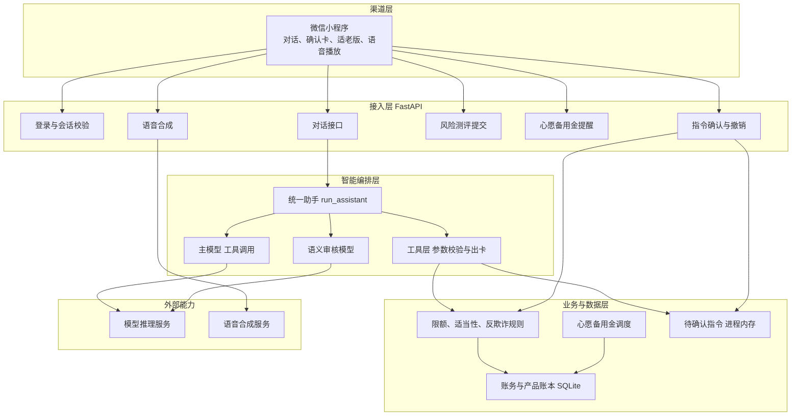
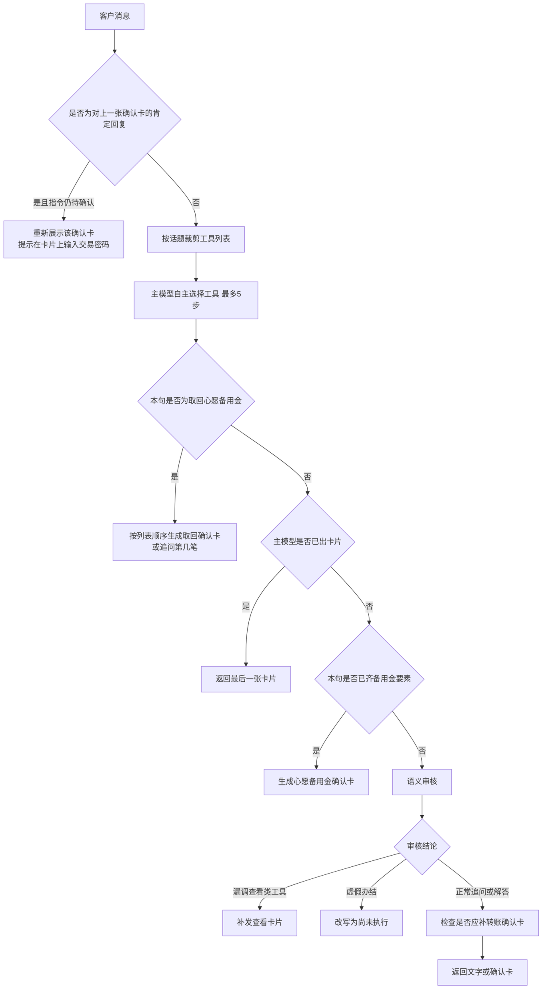
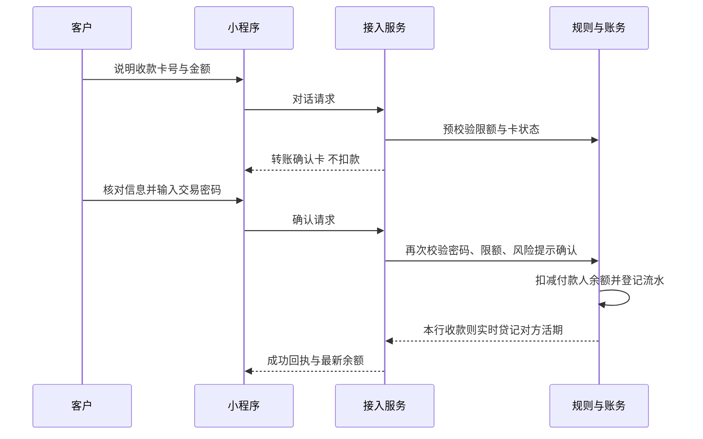

# 智汇银行智能服务系统技术说明书

| 项目 | 内容 |
| --- | --- |
| 文档名称 | 智汇银行智能服务系统技术说明书 |
| 文档性质 | 内部技术汇报材料 |
| 编制依据 | 当前代码实现（后端 `Bank agent/`，微信小程序 `BankingMiniprogram/`） |
| 编制日期 | 2026年11月1日 |
| 适用对象 | 零售业务、金融科技、风险管理与信息安全评审 |

本文档说明系统的总体结构、关键算法和安全控制。文中参数、流程和阈值均以现行代码为准。本系统定位为对话式零售银行演示系统，用于验证“自然语言受理、规则引擎裁决、客户确认后入账”的业务闭环。演示环境的控制强度与生产系统不同，文中在安全设计部分分别列明。

---

## 1. 建设目标与设计原则

系统面向零售客户，在微信小程序中以对话方式办理查询、转账、银行卡管理、代扣管理、风险测评、理财咨询与申购，以及心愿备用金。年长客户可使用大字号界面和语音播报，并可绑定紧急联系人。

设计上坚持四条原则。

1. **模型负责理解，规则负责裁决。** 大模型选择工具并组织话术。余额、限额、卡片状态、风险等级、赎回日和是否入账，由服务端程序判定。
2. **展示与办理分离。** 查询类请求返回业务卡片。转账、申购、资金划转和限额调整先生成待确认指令，客户在确认卡上核对并输入交易密码后，服务端才改写账务。
3. **适当性前置。** 客户没有一年内有效的风险测评时，系统可以展示理财画像，但不得展示可投货架、出具配置建议或生成申购确认单。
4. **话术不得替代事实。** 模型未调用工具时，不得向客户声称已经办理、已经冻结或已经生成确认单。语义审核发现此类表述时，改写为尚未执行。

---

## 2. 系统架构

### 2.1 逻辑架构

系统分为四个层次：渠道层、接入层、智能编排层、业务与数据层。模型推理调用外部推理服务，账务与风控留在本系统内。

### 2.2 组成与职责

| 组成 | 实现位置 | 职责 |
| --- | --- | --- |
| 微信小程序 | `BankingMiniprogram/` | 登录、对话展示、确认卡与交易密码、账单与产品卡片、适老版字号、语音播放、提醒轮询 |
| 接入服务 | `Bank agent/main.py` | HTTP 接口、登录态校验、订单确认、测评计分落库、提醒已读 |
| 统一助手 | `Bank agent/assistant.py` | 会话编排、工具调用循环、语义审核、确认卡回放 |
| 工具层 | `Bank agent/tools.py` | 向模型暴露业务工具，执行前做要素与合规校验 |
| 领域模块 | `Bank agent/agents/` | 转账出卡、理财适当性与推荐、卡片操作、账单、代扣、亲情守护、心愿备用金 |
| 账务与规则 | `Bank agent/database.py` | 客户、账户、流水、产品、限额、测评、紧急联系人、专款账本 |
| 专款日程 | `Bank agent/scenario_service.py` | 用钱日解析、赎回日计算、交易日判断、到期调度 |
| 语音 | `Bank agent/tts_service.py` | 文本转语音，优先神经网络音色，失败时回退本机语音 |
| 模型配置 | `Bank agent/config.py` | 推理服务地址、模型标识、关闭长思考 |

本地联调时，小程序请求本机 `127.0.0.1:8001`。服务启动时自动补齐老库表结构，并启动心愿备用金调度线程。

### 2.3 对话处理流程

客户每句话进入 `POST /api/chat`。服务先校验登录态，再交给统一助手。单轮最多调用模型 5 次。某一步已经生成卡片，循环即停止，避免模型把卡片再复述成文字。

工具分为三类。

| 类别 | 代表工具 | 对客户的效果 |
| --- | --- | --- |
| 只读取数 | `get_account_overview`、`get_spending_breakdown`、`get_risk_and_cashflow`、`get_internal_payees` | 供模型组织文字说明，不直接作为固定视图 |
| 固定视图 | `show_bill_analysis`、`show_bank_cards`、`show_wealth_catalog`、`show_security_center`、`show_wish_reserves` | 小程序渲染标准卡片 |
| 办理预下单 | `stage_transfer`、`stage_wealth_purchase`、`stage_card_action`、`set_up_scenario`、`release_scenario`、`cancel_subscription` | 生成待确认指令，此时不改余额 |

客户谈论选购商品且语句中没有理财语义时，本轮从工具列表中移除理财货架、产品详情、配置建议和申购，避免日常消费被误办成理财。

### 2.4 资金类业务的确认与入账

对话阶段只产生状态为 `PENDING` 的指令，存放在进程内存。入账接口为 `POST /api/order/confirm`（与 `POST /api/transfer/confirm` 同一处理）。确认时再次校验登录态、指令归属、付款卡状态、限额和交易密码。校验通过后才调用账务函数。

转账、理财申购、心愿备用金存入属于资金类指令，确认时必须校验交易密码。调整转账限额的指令同样要求交易密码。挂失、冻结、解冻按卡片操作规则执行。客户在对话中回复“确认”“好的”，只会使确认卡重新出现在对话底部，不能代替卡片上的密码确认。

---

## 3. 核心算法说明

### 3.1 对话编排与语义审核

主模型为 `Qwen/Qwen3.5-122B-A10B`，工具选择策略为自动，采样温度为 0.1，并关闭长思考，以保证工具调用的时延和稳定性。检查模型为 `Qwen/Qwen3.5-35B-A3B`。检查模型不可用时，回退到主模型。两路都无法返回合法结论时，保留主模型原文。

语义审核只在主模型本轮没有产出卡片、且给出了文字时启动。审核结论限于三种。

| 结论 | 处理 |
| --- | --- |
| 漏调查看工具 | 仅允许补调账单、银行卡、订阅、安全中心、理财画像、货架、产品详情、风险问卷、心愿备用金列表 |
| 虚假办结 | 将“已经办理、已经冻结、已经生成确认单”等表述改写为尚未执行 |
| 正常放行 | 保留追问、拒绝非银行业务或分析性说明 |

审核模型不得代发转账、申购、存入或取回确认单，以免检查模型编造金额、日期或收款人。心愿备用金的用钱日以客户原话的日期解析结果为准。转账确认卡仅在客户原话中已经同时出现金额和储蓄卡卡号时补发。

会话历史按用户保存在进程内存，接口返回前保留最近 20 条。写入模型上下文时保留系统提示和最近 10 轮。卡片进入历史时只保留用途、金额、日期、产品名和“待客户点击确认”等摘要，便于后续指代。

### 3.2 投资者风险承受能力评估

问卷共 11 题，覆盖年龄、家庭净资产、可投资产比例、当前配置、风险投资经验、投资态度、收益风险取舍、可接受期限、期望结果、波动焦虑和保本偏好。各选项分值在服务端维护，提交接口只接收选项字母，不接收客户端自报分值。

计分规则：

$$
S = \sum_{i=1}^{11} s(q_i)
$$

缺题时拒绝提交。总分按下列区间映射风险类型与产品等级。

| 得分 | 风险类型 | 等级 | 可适配产品风险等级 |
| --- | --- | --- | --- |
| 15 分及以下 | 保守型 | R1 | 一级 |
| 16–35 | 谨慎型 | R2 | 一级、二级 |
| 36–60 | 稳健型 | R3 | 一级至三级 |
| 61–80 | 进取型 | R4 | 一级至四级 |
| 81–100 | 激进型 | R5 | 一级至五级 |

年龄题同时写入年龄段，供银发识别和配置调整使用。职业由客户在问卷中选择，写入客户档案。测评日期为提交当日。自测评日起 365 日内视为有效。超过 365 日、等级为空或日期无法解析时，视为未持有有效测评。

适当性闸门作用于货架、单品详情、配置建议和申购预下单。产品风险等级数值高于客户等级时，详情与申购被拒绝，并向客户说明原因。系统在话术中声明理财非存款，不保证本金和收益。

### 3.3 现金流画像

画像取近 90 日流水和当前活期余额。流水约定支出金额为正、收入金额为负。设观察期天数为 $D$，支出序列为 $E$，收入绝对值为 $I$，活期余额为 $B$。

$$
\text{月均支出} = \left(\sum E\right) \times \frac{30}{D}
$$

$$
\text{可投闲钱} = \max\left(B - 3 \times \text{月均支出},\, 0\right)
$$

$$
\text{周转率} = \frac{(\sum E + \sum I) / D}{\max(B,\, 1)}
$$

高周转：周转率不低于 0.04，或 90 日内流水不少于 12 笔。

闲钱沉淀：可投闲钱不低于 1,500 元，且支出标准差不超过支出均值的 0.8 倍。无支出样本时，只要求闲钱金额达标。

由此得到四种资金风格：高周转偏流动性、沉淀资金偏稳健锁期、活钱与锁期并存、均衡配置。银发客户按年龄段识别，年龄段包含 51–60、61–65、65 岁以上、60 岁以上或退休表述。

### 3.4 资产配置比例

在客户风险等级对应的基准比例上做三项调整，再归一化到 100%。每一档最低保留 5%。前两档按比例四舍五入，第三档吸收舍入差额。

| 等级 | 活钱管理 | 稳健增值 | 长期增值 |
| --- | --- | --- | --- |
| R1 | 60% | 35% | 5% |
| R2 | 50% | 35% | 15% |
| R3 | 40% | 35% | 25% |
| R4 | 30% | 35% | 35% |
| R5 | 25% | 30% | 45% |

调整规则：

- 高周转：活钱管理增加 10 个百分点，长期增值减少 10 个百分点。
- 闲钱沉淀：长期增值增加 10 个百分点，活钱管理减少 10 个百分点。
- 银发客户：活钱管理增加 15 个百分点，长期增值减少 15 个百分点。

未测评客户不套用默认等级，不给出配置比例。

### 3.5 理财产品匹配

候选集先按客户风险等级截断，只保留不高于客户等级的在售产品。若客户说明了这笔资金的使用时间，再按期限窗口过滤。窗口定义如下。

| 客户表述 | 产品期限（天） |
| --- | --- |
| 活钱，随时可能使用 | 0 |
| 七日，一周内用不上 | 0–7 |
| 月度，一个月内用不上 | 7–30 |
| 半年，半年内用不上 | 30–180 |
| 年度，一年以上用不上 | 180–360 |

过滤后若没有产品，则退回按风险等级截断后的全集，避免无结果。

单只产品基础分为 40。客户已经说明使用时间时，以该时间为主，不再用流水里的周转特征把客户推回短期产品。

- 需要活钱：期限为 0 时加 30 分。
- 其他窗口：设窗口上沿为 $H$、产品期限为 $T$，加分为 $\max(0,\, 24 - \lfloor |H-T| / 7 \rfloor)$。
- 未说明使用时间时：高周转或自由职业类职业优先 7 日内产品（加 35 分）和 30 日内产品（加 8 分）；闲钱沉淀优先 30–90 日（加 32 分）和 180 日以上（加 10 分）；收支平稳时 30 日内产品加 15 分。
- 银发客户：期限不超过 90 日且产品风险不高于 R2 时加 12 分；期限达到 360 日扣 8 分。
- 产品风险与客户等级相同加 4 分；活期类产品加 2 分。
- 已持有同一产品扣 12 分，并在理由中说明可加仓或换期限搭配。

排序键为匹配分降序、期限升序、参考收益降序，保证相同输入下结果稳定。随后做期限分散：先按持有期分档各取一只最高分产品，分档为活期、超短、短期、中期、长期，再用剩余高分产品补足默认 3 只。

推荐说明按“测评依据、闲钱测算、期限搭配、已持仓回避”组织，并请客户确认是否调整。闲钱为 0 时，说明按约 3 个月支出预留备用金，建议从活钱类产品起步。

### 3.6 转账风险识别

风险识别在生成确认卡和密码确认两个时点执行。确认时若等级不是正常，客户须在界面确认已阅读提示，否则拒绝入账。识别使用最近 12 笔转出和近 24 小时转入。大额阈值为单笔 2,000 元。

| 信号 | 触发条件 | 等级 |
| --- | --- | --- |
| 连续大额 | 本笔不低于 2,000 元，且近 72 小时已有同样量级的转出 | 高 |
| 单笔大额 | 本笔不低于 5,000 元，且未构成连续大额 | 关注 |
| 首次大额收款人 | 本笔不低于 2,000 元，且收款人未出现在近期转出对手中 | 至少为关注 |
| 当日高频 | 本笔不低于 2,000 元，且当日已有不少于 5 笔转出 | 至少为关注 |
| 夜间大额 | 本笔不低于 2,000 元，且当地时间处于 0 时至 6 时 | 至少为关注 |
| 整数大额 | 本笔不低于 10,000 元，且金额为 1,000 元的整数倍 | 至少为关注 |
| 快进快出 | 本笔不低于 2,000 元，且近 24 小时存在转入 | 至少为关注 |

多个信号可以叠加。连续大额优先生成为高等级，其余信号在尚未定级时定为关注。等级为高时，若客户已绑定紧急联系人，入账成功后写入一条预警记录，并在回执中告知已通知联系人。当前实现将预警记入本系统，不发送真实短信或微信模板消息。

### 3.7 转账限额

付款工具必须是状态正常的储蓄卡。信用卡、冻结卡、挂失卡和状态异常卡不能付款。收款侧拒绝信用卡和本人账户。卡号格式正确但不是本行账户时，演示环境只扣减付款人余额并登记流水，不向行外清算。

限额按付款卡统计当日金额、当日笔数和当年金额。默认储蓄卡限额为：单笔 20,000 元、日累计 20,000 元、日累计 10 笔、年累计 2,000,000 元。种子客户可按客群设置不同额度。客户自助调额不得超过单笔 500,000 元、日累计 1,000,000 元、日累计 100 笔、年累计 50,000,000 元。

校验顺序为：卡片存在且为正常储蓄卡、金额大于 0、单笔、日笔数、日金额、年金额、活期余额。任一项不满足即拒绝，并给出可执行的调额引导。本笔之后剩余日累计或年累计低于上限的 20%，或日笔数已经用尽时，交易仍可成功，同时在确认信息中给出临界提示。

确认接口在扣款前重新执行上述校验，防止仅依赖前端展示。

### 3.8 心愿备用金日程与参考收益

心愿备用金把一笔活期资金单独登记到指定用钱日。客户必须自己说出用途、金额和今天之后的用钱日。受益人可选，客户未说明时不追问。日期解析支持公历日期、本月或下月某日、明天至大后天，以及本周、下周、下下周的星期。模型补写的日期不作为用钱日。

赎回日算法：

1. 用钱日若落在周末或法定假日，先对齐到前一个工作日，记为资金须就绪日。
2. 自就绪日向前数 3 个工作日，得到计划赎回日。工作日为周一至周五，并扣除内置的国务院放假日期。调休上班的周末仍按非工作日处理，使赎回只可能提前。
3. 若计划赎回日不晚于今天，则把赎回日改为就绪日与下一工作日中的较晚者，避免客户刚确认就被调度线程赎回。
4. 若调整后的赎回日仍晚于就绪日，说明用钱日过近、资金赶不上使用，拒绝建单。

计息起点：当地时间 15:00 以前确认为当日；当日不是工作日，或确认时点在 15:00 及以后，则顺延到下一工作日。底层产品固定为在售的 R1 现金管理产品。参考收益按交易日计提：

$$
\Delta = P \times \frac{y}{365} \times n
$$

其中 $P$ 为当前本金，$y$ 为产品参考年化，$n$ 为自上一个计息点至本交易日的自然日数。周末和法定假日并入下一交易日，不单独计息。收益记入专款台账，赎回或提前取回时与本金一并回到可用余额。系统向客户说明该收益为参考计提，不构成保本或收益承诺。

调度线程约每 30 秒按服务器当地日期检查。赎回日当天将本息划回可用余额，状态改为已完成，并写入未读提醒。用钱日当天若已经完成赎回，再提醒一次可以按计划使用。小程序在页面打开时轮询未读提醒。提前取回须经确认卡和交易密码，成功后状态改为提前结束，本息立即回到可用余额，后续不再做用钱日提醒。

存续列表按用钱日、同一天再按创建时间排序。客户说“第几笔”时按该顺序定位，第一笔序号为 1。

### 3.9 账单时间窗口

客户未说明时间时，支出分析取近 30 日。客户只说月份、未说年份时，由服务端按当天判断：该月已经到来则使用今年，尚未到来则使用去年。客户明确说出今年、去年或具体年份时，才把年份传入工具。异常交易由服务端根据金额偏离识别，供账单卡片展示。

---

## 4. 安全设计

### 4.1 安全目标

| 目标 | 系统中的落实方式 |
| --- | --- |
| 身份可信 | 账号口令校验后签发会话凭证，业务接口校验凭证与客户号一致 |
| 资金操作可确认 | 资金类指令二次校验交易密码、付款卡和限额 |
| 职责分离 | 模型不能直接改写余额、限额、风险等级和订单状态 |
| 适当性 | 测评有效期和产品风险等级由服务端比较 |
| 欺诈提示 | 规则识别大额、夜间、高频、快进快出等特征，高风险留痕并通知紧急联系人 |
| 最小展示 | 登录响应返回脱敏手机号；对话不索取交易密码 |
| 可解释 | 拒绝原因、剩余额度和风险提示返回给渠道，供客户阅读 |

### 4.2 身份鉴别与会话

客户使用手机号或客户号加登录密码进入系统。口令不以明文存放。存储值为固定盐与口令拼接后的 SHA-256 摘要。登录成功后签发 128 位随机凭证，保存在进程内存，后续请求必须同时提交客户号和凭证。凭证与客户号不一致时返回未授权。退出登录时删除凭证。

交易密码与登录密码使用同一套摘要校验。演示数据中两者均为同一初始口令。资金类确认和限额调整在服务端重新校验，不信任渠道自行声明的“已验证”。

手机号对外展示时保留前三后四。紧急联系人手机号按同一规则脱敏。

### 4.3 交易完整性

待确认指令包含客户号、业务类型、金额、对手或产品、付款卡和状态。确认时核对指令仍为待确认，且属于当前客户。客户可以撤销尚未确认的指令。

入账函数在数据库事务中更新余额和流水。心愿备用金同时减少可用余额、增加锁定资金，并写入专款主记录和申购明细。可用余额不足时整笔失败，不产生部分扣款。本行储蓄卡之间转账在同一处理中贷记收款人活期。

模型上下文不包含交易密码。系统提示明确要求模型不得在对话中索要密码。语义审核的改写结果同样禁止出现索要密码的语句。

### 4.4 模型使用边界

发送给推理服务的内容包括系统提示、近期对话摘要和工具返回的业务数据。工具返回用于让模型组织下一句说明。下列事项不交给模型决定：

- 是否扣减余额或锁定资金；
- 限额是否足够、卡片是否可付；
- 风险测评分数和等级；
- 产品是否超出客户风险等级；
- 心愿备用金的赎回日和计息结果；
- 交易密码是否正确。

工具说明中不放置具体客户姓名、卡号或手机号示例，避免模型把示例数据写入当前客户的备注或对手信息。用途、受益人、收款卡号和商户名要求照录客户原话。

### 4.5 数据与密钥

业务数据存放在服务端本地 SQLite 数据库，路径固定为后端目录下的 `bank.db`，避免因启动目录不同生成多份账本。模型访问密钥从环境变量读取。密钥、数据库文件和语音缓存不应纳入版本库。

适老版语音优先调用外部神经网络语音，并按文本与音色缓存结果。外部连接失败时，本次改用操作系统语音合成，下一句仍优先尝试神经网络语音。

### 4.6 隐私与适老保护

银发客户登录后，渠道默认使用适老界面。安全中心展示紧急联系人绑定状态、历史预警和防骗提示。绑定联系人必须提供姓名和合法手机号，关系限于子女、父母、配偶、亲属或其他。

高风险转账的通知对象是客户本人绑定的联系人。通知内容包含风险标题、收款人和金额。演示环境只在本系统留存记录并在回执中展示，不向运营商或即时通讯渠道外发。

### 4.7 演示环境与投产要求

下列事项是当前演示实现的客观边界。若进入银行生产或准生产，应在现有业务闭环之上替换为行内标准控制，而不改变“模型不直接入账”的架构。

| 领域 | 当前演示实现 | 投产时应达到的控制 |
| --- | --- | --- |
| 口令存储 | 固定盐 SHA-256，登录口令与交易口令同一摘要 | 分项口令、慢哈希或硬件加密，并实施错误次数锁定 |
| 会话 | 进程内存凭证，服务重启即失效，无独立有效期和设备绑定 | 集中会话、空闲超时、绝对超时、退出全端失效 |
| 传输 | 本地明文 HTTP | 全链路 TLS，渠道证书校验 |
| 指令与会话 | 待确认指令和对话历史在进程内存 | 持久化、幂等、超时作废，并纳入交易审计 |
| 账务 | 单机 SQLite | 行内核心或账务中台，借贷平衡与日终对账 |
| 行外转账 | 仅扣减演示账户 | 接入支付清算与收款行校验 |
| 模型数据 | 对话与工具结果发往外部推理服务 | 行内模型或专有云，数据出境与脱敏评估，提示词与输出审计 |
| 密钥 | 环境变量中的推理密钥 | 密钥管理系统、定期轮换、最小权限 |
| 紧急联系人通知 | 系统内记录 | 经行内消息平台发送，并记录送达回执 |
| 反欺诈 | 固定阈值规则 | 与行内反欺诈、反洗钱名单和设备指纹联动 |
| 语音 | 外部语音服务，失败回退本机 | 行内语音能力，文本脱敏后送入 |
| 高可用与审计 | 单进程 | 多实例、操作日志、模型调用日志和管理员审计 |

### 4.8 已知风险的处理立场

演示数据库中的初始口令仅用于功能演示，不得作为任何真实客户的口令策略。推理密钥若出现在本地配置文件中，只允许留在运行机器，不得提交到代码仓库或写入本说明书。外部推理服务能够看到客户对话中的账户摘要、金额和对手信息，因此本系统在完成数据出境评估前，只应用于脱敏演示数据。

---

## 5. 主要接口

除特别说明外，业务接口均要求有效登录凭证，且凭证绑定的客户号与请求客户号一致。

| 方法 | 路径 | 作用 |
| --- | --- | --- |
| POST | `/api/auth/login` | 校验账号口令，返回凭证、脱敏资料、风险等级、是否银发、紧急联系人状态和余额 |
| POST | `/api/auth/logout` | 注销凭证 |
| POST | `/api/chat` | 提交一句话，返回文字或卡片，并附当前余额 |
| POST | `/api/order/confirm` | 校验密码后执行待确认指令 |
| POST | `/api/order/cancel` | 撤销待确认指令 |
| POST | `/api/risk/survey` | 提交问卷选项，服务端计分并返回配置建议 |
| GET | `/api/user/balance` | 查询活期余额 |
| GET | `/api/scenario/notices` | 拉取未读的到账提醒和用钱日提醒 |
| POST | `/api/scenario/notices/read` | 将提醒标记为已读 |
| GET | `/api/guardian/center` | 查询安全防护信息 |
| POST | `/api/guardian/bind` | 绑定或更新紧急联系人 |
| GET | `/api/tts` | 将指定文本合成为语音 |

---

## 6. 主要数据

| 数据 | 内容 |
| --- | --- |
| 客户 | 客户号、姓名、手机号、口令摘要、风险等级、风险类型、得分、测评日期、年龄段、职业、问卷原文、紧急联系人 |
| 账户 | 可用余额、锁定资金 |
| 银行卡 | 卡种、状态、单笔限额、日累计金额、日累计笔数、年累计金额 |
| 流水 | 金额、分类、对手、附言、时间、付款卡 |
| 理财产品 | 风险等级、期限、参考收益、起购金额、销售状态 |
| 订阅 | 商户、金额、周期、下次扣款日、状态 |
| 心愿备用金 | 用途、本金、累计参考收益、用钱日、赎回日、计息日、状态 |
| 专款明细 | 申购、收益计提、赎回或提前结束 |
| 提醒与预警 | 未读提醒、紧急联系人预警记录 |

心愿备用金状态包括存续、已完成和提前结束。列表对已完成和提前结束作出标注，避免被理解为正常持有到期。

---

## 7. 汇报结论

本系统已经形成可演示的零售对话闭环：渠道采集客户语言，模型选择业务工具，服务端规则决定是否出卡和是否入账，客户在确认卡上完成资金授权。风险测评、产品适当性、转账限额、反欺诈提示、紧急联系人留痕和心愿备用金日程均由确定性程序执行，模型不能绕过这些控制直接改账。

作为向银行专业部门的汇报材料，应同时明确其边界。当前实现用于验证业务与架构，口令学、会话、传输、账务一致性、模型数据驻留和外部通知仍停留在演示强度。生产化的工作重点是把上述控制替换为行内标准组件，并保留“自然语言受理、规则裁决、客户确认后入账”这一职责划分。
